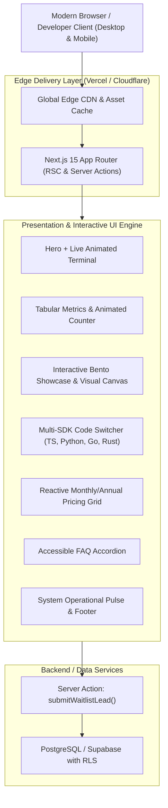

# System Documentation & Architecture Topology
## Project: Kortex AI — Landing Page Architecture

### 1. High-Level Architecture Topology



---

### 2. Component Directory Structure

```text
c:\Users\roedy\Documents\antigravity\gallant-bell
├── app/
│   ├── layout.tsx            # Global Root Layout (Geist Sans, Geist Mono, metadata, SEO)
│   ├── page.tsx              # Landing Page Orchestrator (Single-page composition)
│   ├── globals.css           # Tailwind CSS v4 directives & custom utilities
│   ├── actions.ts            # Next.js Server Actions (Waitlist lead intake with Zod)
│   └── icon.svg              # High-res SVG favicon and app badge
├── components/
│   ├── Navbar.tsx            # Sticky header with glassmorphism and mobile drawer
│   ├── Hero.tsx              # Headline, CTA group, and interactive terminal
│   ├── InteractiveTerminal.tsx # Live simulated agent orchestration logs
│   ├── TelemetryBar.tsx      # Real-time tabular numerals & social proof metrics
│   ├── BentoGrid.tsx         # Linear-style bento cards with interactive micro-demos
│   ├── CodeSandbox.tsx       # Tabbed multi-language SDK code snippet viewer
│   ├── ArchitectureShowcase.tsx # Reactive SVG agent node mesh visualizer
│   ├── Pricing.tsx           # Monthly/Annual toggle pricing cards with feature list
│   ├── WaitlistModal.tsx     # Accessible interactive early-access dialog
│   ├── Faq.tsx               # Collapsible accordion FAQ
│   └── Footer.tsx            # Operational edge status and footer navigation
├── lib/
│   ├── utils.ts              # cn() class merge helper (clsx + tailwind-merge)
│   └── types.ts              # Domain interfaces and TypeSpec contracts
├── public/                   # Static vector assets, logos, and meta images
├── PRD.md                    # Product Requirements Document
├── ERD.md                    # Database Schema, DDL & RLS Policies
├── DOCUMENTATION.md          # System Architecture & Component Topology
└── CONTEXT_MAP.md            # Subagent Interface & TypeSpec Slices
```

---

### 3. State Management & Interaction Strategy
- **Zero-Hydration Bloat**: Components are divided into React Server Components (RSC) for static layouts and lean Client Components (`'use client'`) only where user interaction is required (terminal stream, SDK tabs, pricing toggle, waitlist modal).
- **No Heavy External Heavyweights**: Using native React 19 primitives (`useState`, `useActionState`, `useTransition`), lightweight Lucide icons, and modern CSS `@keyframes` instead of 500kb JS animation bundles.
- **Accessible Focus States**: All interactive elements support strict 5-state visuals (Default, Hover, Focus-Visible `ring-2 ring-amber-500`, Active, Disabled).
