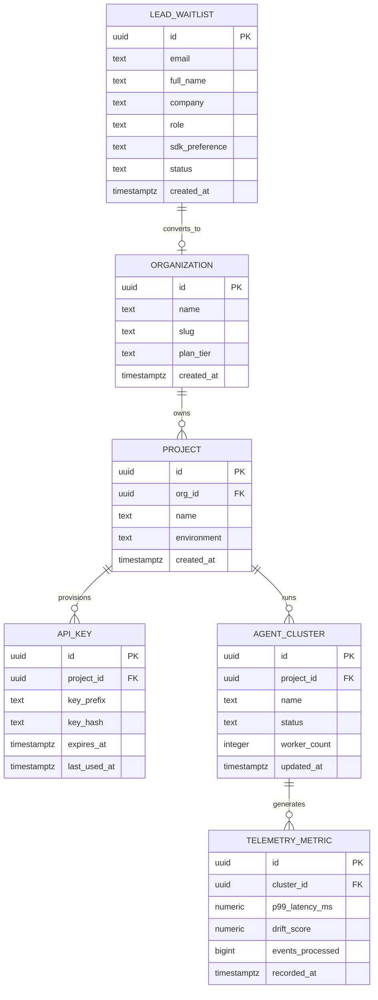

# Entity Relationship Diagram & Database Schema (ERD)
## Project: Kortex AI — Autonomous Agent Infrastructure

### 1. Conceptual Entity Diagram (Mermaid)



---

### 2. Production PostgreSQL DDL Schema

```sql
-- Enable necessary cryptographic and UUID extensions
CREATE EXTENSION IF NOT EXISTS "uuid-ossp";
CREATE EXTENSION IF NOT EXISTS "pgcrypto";

-- Enum Types
CREATE TYPE plan_tier_enum AS ENUM ('developer', 'pro', 'enterprise');
CREATE TYPE waitlist_status_enum AS ENUM ('pending', 'approved', 'invited', 'rejected');
CREATE TYPE cluster_status_enum AS ENUM ('initializing', 'active', 'degraded', 'offline');

-- 1. Waitlist & Early Access Leads Table
CREATE TABLE public.lead_waitlist (
    id UUID PRIMARY KEY DEFAULT gen_random_uuid(),
    email TEXT NOT NULL UNIQUE,
    full_name TEXT,
    company TEXT,
    role TEXT,
    sdk_preference TEXT DEFAULT 'typescript' NOT NULL,
    ip_address INET,
    user_agent TEXT,
    status waitlist_status_enum DEFAULT 'pending' NOT NULL,
    metadata JSONB DEFAULT '{}'::jsonb NOT NULL,
    created_at TIMESTAMPTZ DEFAULT clock_timestamp() NOT NULL,
    updated_at TIMESTAMPTZ DEFAULT clock_timestamp() NOT NULL
);

-- Index for rapid lookup and status queue processing
CREATE INDEX idx_lead_waitlist_status_created ON public.lead_waitlist (status, created_at DESC);
CREATE INDEX idx_lead_waitlist_email ON public.lead_waitlist (email);

-- 2. Organizations Table
CREATE TABLE public.organizations (
    id UUID PRIMARY KEY DEFAULT gen_random_uuid(),
    name TEXT NOT NULL,
    slug TEXT NOT NULL UNIQUE,
    plan_tier plan_tier_enum DEFAULT 'developer' NOT NULL,
    stripe_customer_id TEXT UNIQUE,
    is_active BOOLEAN DEFAULT true NOT NULL,
    created_at TIMESTAMPTZ DEFAULT clock_timestamp() NOT NULL,
    updated_at TIMESTAMPTZ DEFAULT clock_timestamp() NOT NULL
);

CREATE INDEX idx_organizations_slug ON public.organizations (slug);

-- 3. Projects Table
CREATE TABLE public.projects (
    id UUID PRIMARY KEY DEFAULT gen_random_uuid(),
    org_id UUID NOT NULL REFERENCES public.organizations(id) ON DELETE CASCADE,
    name TEXT NOT NULL,
    environment TEXT DEFAULT 'production' NOT NULL,
    created_at TIMESTAMPTZ DEFAULT clock_timestamp() NOT NULL,
    updated_at TIMESTAMPTZ DEFAULT clock_timestamp() NOT NULL
);

CREATE INDEX idx_projects_org_id ON public.projects (org_id);

-- 4. API Keys Table (Hashed storage)
CREATE TABLE public.api_keys (
    id UUID PRIMARY KEY DEFAULT gen_random_uuid(),
    project_id UUID NOT NULL REFERENCES public.projects(id) ON DELETE CASCADE,
    name TEXT NOT NULL,
    key_prefix TEXT NOT NULL,
    key_hash TEXT NOT NULL UNIQUE,
    last_used_at TIMESTAMPTZ,
    expires_at TIMESTAMPTZ,
    created_at TIMESTAMPTZ DEFAULT clock_timestamp() NOT NULL
);

CREATE INDEX idx_api_keys_lookup ON public.api_keys (key_prefix, key_hash);

-- 5. Agent Clusters Table
CREATE TABLE public.agent_clusters (
    id UUID PRIMARY KEY DEFAULT gen_random_uuid(),
    project_id UUID NOT NULL REFERENCES public.projects(id) ON DELETE CASCADE,
    name TEXT NOT NULL,
    status cluster_status_enum DEFAULT 'active' NOT NULL,
    worker_count INTEGER DEFAULT 1 NOT NULL,
    region TEXT DEFAULT 'iad-edge' NOT NULL,
    created_at TIMESTAMPTZ DEFAULT clock_timestamp() NOT NULL,
    updated_at TIMESTAMPTZ DEFAULT clock_timestamp() NOT NULL
);

CREATE INDEX idx_agent_clusters_project_id ON public.agent_clusters (project_id);

-- 6. Telemetry Metrics Table (Wide-event / Timescale ready)
CREATE TABLE public.telemetry_metrics (
    id UUID PRIMARY KEY DEFAULT gen_random_uuid(),
    cluster_id UUID NOT NULL REFERENCES public.agent_clusters(id) ON DELETE CASCADE,
    p99_latency_ms NUMERIC(6, 3) NOT NULL,
    drift_score NUMERIC(5, 4) DEFAULT 0.0000 NOT NULL,
    events_processed BIGINT DEFAULT 0 NOT NULL,
    recorded_at TIMESTAMPTZ DEFAULT clock_timestamp() NOT NULL
);

CREATE INDEX idx_telemetry_cluster_time ON public.telemetry_metrics (cluster_id, recorded_at DESC);

---

### 3. Row Level Security (RLS) Policies

```sql
-- Enable RLS across all tables
ALTER TABLE public.lead_waitlist ENABLE ROW LEVEL SECURITY;
ALTER TABLE public.organizations ENABLE ROW LEVEL SECURITY;
ALTER TABLE public.projects ENABLE ROW LEVEL SECURITY;
ALTER TABLE public.api_keys ENABLE ROW LEVEL SECURITY;
ALTER TABLE public.agent_clusters ENABLE ROW LEVEL SECURITY;
ALTER TABLE public.telemetry_metrics ENABLE ROW LEVEL SECURITY;

-- 1. Lead Waitlist: Anonymous public can insert; only service_role can select/update
CREATE POLICY "Public insert allowed for lead_waitlist"
    ON public.lead_waitlist
    FOR INSERT
    TO anon, authenticated
    WITH CHECK (true);

CREATE POLICY "Service role full access on lead_waitlist"
    ON public.lead_waitlist
    FOR ALL
    TO service_role
    USING (true)
    WITH CHECK (true);

-- 2. Organizations: Members can view their own organization
CREATE POLICY "Users can view organizations they belong to"
    ON public.organizations
    FOR SELECT
    TO authenticated
    USING (
        id IN (
            SELECT org_id FROM auth.users WHERE auth.uid() = id
        )
    );

-- 3. Telemetry Metrics: Public can read anonymized aggregated stats for the landing page showcase
CREATE POLICY "Public read aggregated telemetry metrics"
    ON public.telemetry_metrics
    FOR SELECT
    TO anon, authenticated
    USING (true);
```
